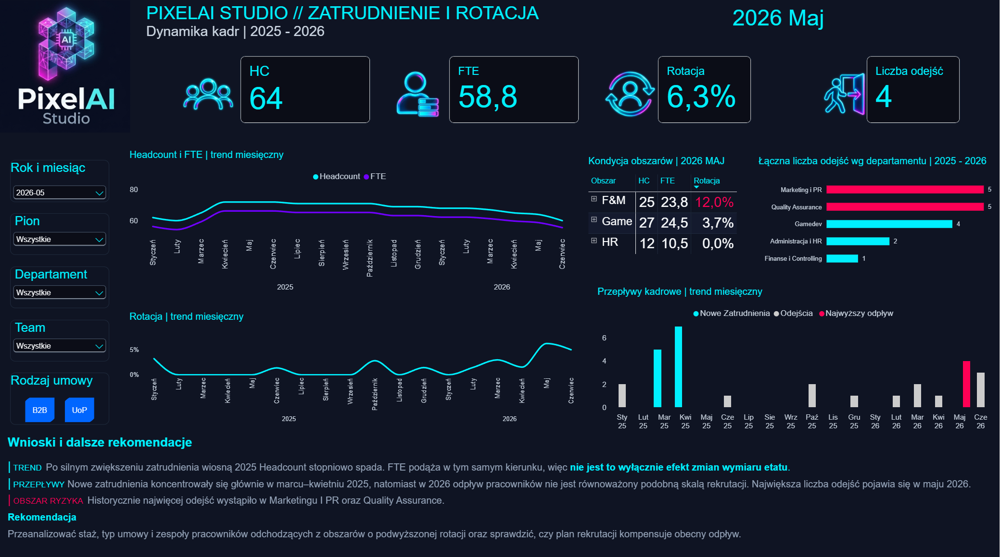
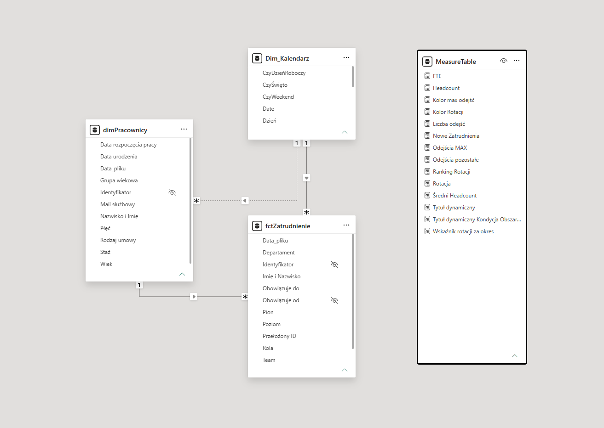

# HR-Analytics-PowerBI-PixelAI
HR Analytics Dashboard | Power BI, Power Query, DAX, Data Modeling

## Project Overview

An HR analytics dashboard developed as part of the **#WyzwaniePowerBI** challenge organized by SkuteczneRaporty.pl.

The project covers the end-to-end analytical workflow, from raw CSV files to an interactive Power BI dashboard.

## Business Objective

To support HR decision-making by analyzing workforce dynamics, employment levels, FTE, employee turnover, and hiring and departure trends.

## Tools & Technologies

- Power BI
- Power Query (ETL)
- DAX
- Data Modeling
- CSV

## Key Metrics

- **Headcount:** Number of employees
- **FTE:** Full-Time Equivalent
- **Employee Turnover:** Workforce turnover rate
- **New Hires & Departures:** Monthly workforce movements
- **Department Analysis:** Distribution of employees and departures across organizational units

## Analytical Workflow

1. Imported and transformed CSV data using Power Query.
2. Prepared employee and employment datasets.
3. Developed a data model with a calendar dimension.
4. Created DAX measures for HR KPIs and time-based analysis.
5. Designed an interactive dashboard with dynamic titles and filters.
6. Identified workforce trends and potential HR risk areas.

## Key Insights

- Headcount and FTE declined after the spring 2025 recruitment increase.
- Recruitment activity was concentrated in March and April 2025.
- Historical departures were concentrated in Marketing & PR and Quality Assurance.
- The analysis highlights the importance of monitoring whether recruitment compensates for employee departures.

## Dashboard Preview

## Data Model

## Live Interactive Dashboard

Explore the interactive Power BI dashboard:

[**View Live Power BI Report**](https://app.powerbi.com/view?r=eyJrIjoiNDYzZWQwODMtODg1Yy00MjdjLWFiMmQtNGM5NGZkNDZiN2I3IiwidCI6IjNkZmU5YWI2LTgxYmYtNDkxYy1iNjcwLTAxYzgyNGEwOWUxOSJ9&embedImagePlaceholder=true)

## Acknowledgements

Project completed as part of **#WyzwaniePowerBI** by Bartosz Czapiewski / SkuteczneRaporty.pl.
